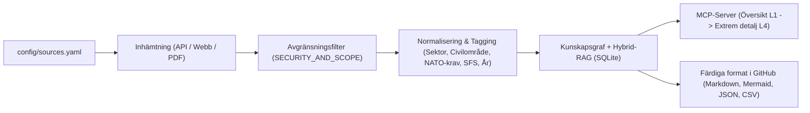

# Källkatalog & Övervakningsarkitektur – Svenskt Totalförsvar & NATO

Detta dokument beskriver vilka domäner, API:er och dokumentflöden som övervakas och bearbetas i [`flinnander/totalforsvaret`](https://github.com/flinnander/totalforsvaret), samt hur den maskinläsbara konfigurationen i [`config/sources.yaml`](../config/sources.yaml) är uppbyggd.

> [!IMPORTANT]
> **Strikt avgränsning (Se [`SECURITY_AND_SCOPE.md`](../SECURITY_AND_SCOPE.md)):**
> Projektet samlar **endast** öppna källor som beskriver **vad totalförsvaret är, vilka aktörer som ingår samt vilka formella lagar, uppdrag och krav som gäller**. Vi undviker och filtrerar aktivt bort material som redovisar *hur väl olika aktörer svarar upp mot kraven*, brister, mognadsbedömningar eller risk- och sårbarhetsanalyser (RSA).

---

## 1. Hur vi hanterar NATO och "Crisis Response Measures" (NCRS / NRS)

För att förklara hur Sveriges totalförsvar hänger ihop med NATO – utan att samla in uppfyllnads- eller sårbarhetsbedömningar – modellerar vi de **formella och konceptuella ramverken**:

1. **NATO Crisis Response System (NCRS) / NATO Response System (NRS) & Crisis Response Measures (CRM):**
   - Konceptuell och förvaltningsrättslig koppling: hur NATO:s krishanteringssystem är uppbyggt enligt öppna NATO-publikationer och hur svensk lagstiftning/regeringsbeslut beskriver kopplingen till svenska beredskapsåtgärder och höjd beredskap.
2. **NATO:s sju grundläggande krav på civil motståndskraft (*Seven Baseline Requirements*, Artikel 3):**
   - I [`config/sources.yaml`](../config/sources.yaml) är var och en av Sveriges **12 beredskapssektorer** mappad direkt mot NATO:s sju resilienskrav:
     1. *Säkerställa politiskt beslutsfattande och centrala ledningsfunktioner* (`continuity_of_government`)
     2. *Resilient energiförsörjning* (`resilient_energy_supplies`)
     3. *Hantera okontrollerade befolkningsrörelser / utrymning* (`uncontrolled_movement_of_people`)
     4. *Resilient livsmedels- och dricksvattenförsörjning* (`resilient_food_and_water_resources`)
     5. *Hantera masskadeutfall och hälsokriser* (`ability_to_deal_with_mass_casualties`)
     6. *Resilienta civila kommunikationssystem* (`resilient_civil_communications`)
     7. *Resilienta transportsystem* (`resilient_transport_systems`)
3. **Värdlandsstöd (*Host Nation Support, HNS*) & DCA-avtalet:**
   - Formella regelverk, roller och ansvarsfördelning i svensk lag och öppen NATO-doktrin.
4. **NDPP (*NATO Defence Planning Process*):**
   - Hur NATO:s försvarsplaneringsprocess principiellt samspelar med riksdagens försvarsbeslut och regeringens styrning.

---

## 2. Översikt över de 7 källkategorierna

| Kategori | Exempel på domäner / API:er | Metod | Uppdateringsintervall |
| :--- | :--- | :--- | :--- |
| **1. Riksdag, Regering & Regleringsbrev** | `data.riksdagen.se`, `regeringen.se`, `esv.se` (endast formella uppdrag i regleringsbrev, ej återrapportering), `riksbank.se` | REST-API, RSS & strukturerad parser | Veckovis (intensivt dec–jan) |
| **2. NATO & Alliansramverk** | `nato.int`, `act.nato.int`, `shape.nato.int`, `hybridcoe.fi`, `ccdcoe.org` | Kurerad webb & öppna doktrin-PDF:er | Månadsvis / Kvartalsvis |
| **3. Militärt försvar & Kunskapsmyndigheter** | `forsvarsmakten.se`, `mcf.se` (`msb.se`), `mpf.se`, `foi.se`, `fhs.se`, `pliktverket.se`, `fmv.se`, `fra.se` (`ncsc.se`), `mtfa.se` (endast systemöversikter) | Kurerad webb, föreskrifter & handböcker | Veckovis / Månadsvis |
| **4. De 12 Beredskapssektorerna (~67 myndigheter)** | `energimyndigheten.se`, `svk.se`, `pts.se`, `trafikverket.se`, `socialstyrelsen.se`, `livsmedelsverket.se`, `polisen.se`, `fi.se`, `skatteverket.se`, `tillvaxtverket.se`, `kommerskollegium.se` m.fl. | Fokuserad insamling av roller, instruktioner & föreskrifter | Månadsvis |
| **5. Regional & Kommunal nivå** | `lansstyrelsen.se` (6 civilområden + 21 län), `skr.se` | Ansvarsfördelning & LEH-ramverk (ej RSA) | Månadsvis |
| **6. Frivilligförsvar (18 FFO) & Näringsliv** | `frivilligforsvaret.se`, `civil.se`, `forsvarsutbildarna.se`, `svenskalottakaren.se`, `fro.se`, `redcross.se`, `svensktnaringsliv.se`, `energiforetagen.se` | Kurerad webb | Kvartalsvis |
| **7. Akademi & Utbildning** | `campustotalforsvar.se` (inkl. alla 37 samverkande svenska lärosäten) | Kurerad webb & utbildnings-/forskningsteman | Månadsvis |

---

## 3. Planerat dataflöde (Övervakning -> Filtrering -> Flernivå-utdata)

