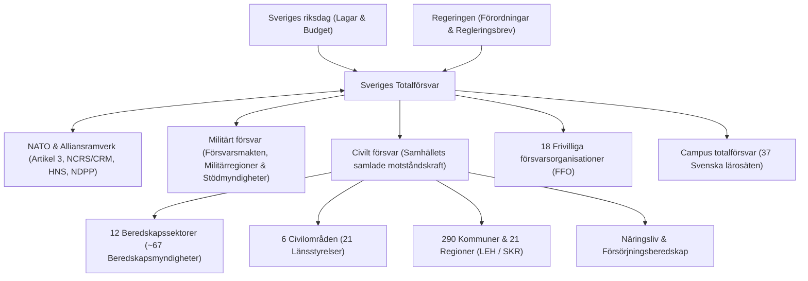

# Svenskt Totalförsvar – Exekutiv Helhetsbild (Nivå L1)

> Automatgenererad ur projektets kunskapsgraf (`183` noder, `325` kopplingar, `11` indexerade rättskällor med `269` sökbara textavsnitt).

## Systemkarta

## Nyckeltal i strukturen
* **12 nationella beredskapssektorer** med var sin sektorsansvarig myndighet enligt *förordning (2022:524)*.
* **6 geografiska civilområden** ledda av civilområdesansvariga länsstyrelser i samspel med 21 län/regioner och 290 kommuner.
* **7 grundläggande NATO-krav på civil motståndskraft** (*Seven Baseline Requirements*, Artikel 3) mappade direkt mot Sveriges beredskapssektorer.
* **18 frivilliga försvarsorganisationer (FFO)** som förstärker både militärt och civilt försvar.
* **37 universitet och högskolor** förenade i **Campus totalförsvar** för forskning och utbildning.

## Centrala lagar och förordningar (SFS)
- **SFS 1978:561** – [Ransoneringslag (1978:561)](https://www.riksdagen.se/sv/dokument-och-lagar/dokument/svensk-forfattningssamling/_sfs-1978-561/): Möjliggör reglering och ransonering av livsmedel, drivmedel och andra förnödenheter vid försörjningskriser eller krig.
- **SFS 1978:599** – [Förfogandelag (1978:599)](https://www.riksdagen.se/sv/dokument-och-lagar/dokument/svensk-forfattningssamling/_sfs-1978-599/): Ger staten rätt att under krig eller höjd beredskap ta i anspråk egendom och tjänster som behövs för totalförsvaret.
- **SFS 1982:1004** – [Lag (1982:1004) om skyldighet för näringsidkare, arbetsmarknadsorganisationer m.fl. att delta i totalförsvarsplaneringen](https://www.riksdagen.se/sv/dokument-och-lagar/dokument/svensk-forfattningssamling/_sfs-1982-1004/): Grunden för näringslivets medverkan i totalförsvarsplaneringen och utpekande av samhällsviktiga företag (K-företag).
- **SFS 1992:1403** – [Lag (1992:1403) om totalförsvar och höjd beredskap](https://www.riksdagen.se/sv/dokument-och-lagar/dokument/svensk-forfattningssamling/_sfs-1992-1403/): Grundläggande lag som definierar totalförsvaret (militärt och civilt försvar) samt beredskapsgraderna skärpt beredskap och högsta beredskap.
- **SFS 1994:1809** – [Lag (1994:1809) om totalförsvarsplikt](https://www.riksdagen.se/sv/dokument-och-lagar/dokument/svensk-forfattningssamling/_sfs-1994-1809/): Reglerar värnplikt, civilplikt och allmän tjänsteplikt för alla som bor i Sverige mellan 16 och 70 års ålder.
- **SFS 2006:544** – [Lag (2006:544) om kommuners och regioners åtgärder inför och vid extraordinära händelser i fredstid och höjd beredskap (LEH)](https://www.riksdagen.se/sv/dokument-och-lagar/dokument/svensk-forfattningssamling/_sfs-2006-544/): Styr kommunernas (290 st) och regionernas (21 st) ansvar under kris och höjd beredskap.
- **SFS 2006:637** – [Förordning (2006:637) om kommuners och regioners åtgärder inför och vid extraordinära händelser i fredstid och höjd beredskap](https://www.riksdagen.se/sv/dokument-och-lagar/dokument/svensk-forfattningssamling/_sfs-2006-637/): Kompletterande förordning till LEH avseende geografiskt områdesansvar och planering.
- **SFS 2015:1053** – [Förordning (2015:1053) om totalförsvar och höjd beredskap](https://www.riksdagen.se/sv/dokument-och-lagar/dokument/svensk-forfattningssamling/_sfs-2015-1053/): Reglerar krigsorganisation, beredskapslarm och myndigheters planering för höjd beredskap.
- **SFS 2018:585** – [Säkerhetsskyddslag (2018:585)](https://www.riksdagen.se/sv/dokument-och-lagar/dokument/svensk-forfattningssamling/_sfs-2018-585/): Normativt regelverk för skydd av säkerhetskänslig verksamhet och säkerhetsskyddsklassificerade uppgifter.
- **SFS 2020:782** – [Lag (2020:782) om operativt militärt stöd](https://www.riksdagen.se/sv/dokument-och-lagar/dokument/svensk-forfattningssamling/_sfs-2020-782/): Reglerar ramarna för mottagande och lämnande av militärt stöd samt värdlandsstöd i samverkan med allierade.
- **SFS 2022:524** – [Förordning (2022:524) om statliga myndigheters beredskap](https://www.riksdagen.se/sv/dokument-och-lagar/dokument/svensk-forfattningssamling/_sfs-2022-524/): Beredskapsförordningen som pekar ut Sveriges ~67 beredskapsmyndigheter, de 12 beredskapssektorerna, sektorsansvariga myndigheter och de 6 civilområdena.
